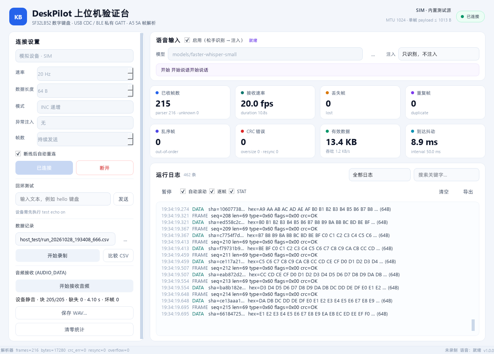

# py_example — 上位机通信验证程序

按 [`docs/上位机通信验证.md`](../docs/上位机通信验证.md) 实现的上位机程序：USB CDC 与 BLE 私有 GATT
共用**同一个帧解析器**和**同一套输出格式**，用于验证设备端 `test_src → proto_send → link` 发出的
`A5 5A` 帧。

协议与传输核心为纯 Python（≥3.10）；图形界面使用 PySide6，命令行模式无需 Qt。

## 1. 目录

```
py_example/
  __main__.py          # python -m py_example
  cli.py               # 参数、主循环、重连、回环、固定输出
  gui.py               # PySide6 浅色图形界面（--gui）
  frame.py             # crc16 / build_frame / FrameParser（状态机）
  check.py             # 序号/模式/抖动校验，CSV 录制与跨链路比较
  audio_rx.py          # AUDIO_CTL/AUDIO_DATA：按段 WAV + 可选 ASR/注入
  win_audio.py         # Windows waveOut 实时播放
  voice/
    session.py         # VoiceSession：AUDIO_CTL 分段、ADPCM 汇总
    controller.py      # 段结束 → 解码 → ASR → 注入（worker 线程）
    inject.py          # SendInput / 剪贴板兜底
    postprocess.py     # 文本清理
    asr/base.py        # AsrEngine / AsrResult
    asr/faster_whisper_engine.py
    download_model.py  # ModelScope 模型下载
    asr_file.py        # 对已有 WAV 做 ASR
  selftest.py          # 无硬件自检（H5–H9、语音分段等 29 项）
  ui_preview.png       # 图形界面预览
  transport/
    base.py            # Transport 抽象
    serial_tx.py       # USB CDC（pyserial）
    ble_tx.py          # BLE GATT（bleak，DATA_TX/DATA_RX）
    sim_tx.py          # 模拟设备（无硬件演示 + 异常注入 + 回环）
  requirements.txt
  requirements-voice.txt
models/
  faster-whisper-small/  # 本地 ASR 模型（约 486 MB，按需下载）
```

依赖只在对应模式里才需要：

| 模式 | 依赖 |
|---|---|
| `--transport sim`、`--selftest`、`--compare` | 无（仅标准库） |
| `--transport usb` | `pyserial` |
| `--transport ble` | `bleak`（Win10 1809+） |
| `--gui` | `PySide6-Essentials` |
| 语音识别 | `faster-whisper`、`numpy`、本地模型（见 `requirements-voice.txt`） |

```powershell
python -m pip install -r py_example/requirements.txt
```

### 已创建的 Conda 环境（kbhost）

本机 Miniconda 中已创建并验证。环境目录：`D:\Miniconda\envs\kbhost`；
conda 包缓存：`D:\Miniconda\pkgs`。

```powershell
conda env list                 # 应看到 kbhost
conda activate kbhost          # PowerShell 需已 conda init；否则用 Anaconda Prompt
python --version               # Python 3.12.15
python -c "import serial, bleak; print(serial.__version__)"   # 3.5
cd G:\Code\My_Project\DigitalKeyboard\JnWorkerStream
python -m py_example --selftest
```

该环境已安装 `pyserial 3.5`、`bleak 3.0.2`、`PySide6-Essentials 6.12`、
`faster-whisper 1.2.1`（含 ctranslate2 / onnxruntime / av / numpy），可直接跑 USB/BLE/SIM/GUI/ASR。
若后续还要装包，注意本机原配置的清华 PyPI 镜像返回 403，可临时改用：

```powershell
python -m pip install --index-url https://mirrors.aliyun.com/pypi/simple --trusted-host mirrors.aliyun.com <包名>
```

## 2. 快速开始

### 图形界面（推荐日常使用）

```powershell
python -m py_example --gui
# 或
python -m py_example.gui

# 不保留控制台窗口（kbhost 环境）
pythonw -m py_example --gui
```



界面能力：

- **浅色主题**、卡片式统计区，连接状态、MTU、实际单帧上限一眼可见。
- **彩色日志**：`LINK / FRAME / DATA / STAT / ECHO / WARN / ERROR / REC` 不同颜色；错误/警告带浅色底。
- **日志可查看性**：暂停、按类别筛选、关键字搜索、自动滚动、清空、导出 txt。
- USB / BLE / SIM 三种链路；BLE 可列出 Windows 已配对设备，设备被 HID 占用不广播时也能直连。
- 实时统计：帧数、速率、丢失、重复、乱序、CRC、有效数据、抖动。
- 回环测试、CSV 录制（开始/停止）、两份 CSV 比较。
- 断线自动重连；状态卡、日志和底部解析器统计同步更新。
- 高频测试时可关闭“逐帧记录 FRAME / DATA”，只保留每秒 STAT，避免日志刷屏。
- **语音输入卡**：启用后松手自动识别、结果直接显示并可注入当前焦点窗口。

### 语音输入（V1）

设备端已实现 KEY1 PTT：按下发 `AUDIO_CTL(ev=0, seg_id=N)`，松开发 `AUDIO_CTL(ev=1, seg_id=N)`。
主机按 `seg_id` 切段，不需要 VAD/静音检测。

```powershell
# 1) 安装 ASR 依赖（kbhost 已装）
python -m pip install -r py_example/requirements-voice.txt

# 2) 下载 small 模型到 models/faster-whisper-small（kbhost 已下载）
python -m py_example.voice.download_model --model small

# 3) GUI：连接设备 → 勾选右上角“启用” → 把焦点放到记事本/浏览器/VS Code → 按 KEY1 说话
python -m py_example --gui

# 4) CLI：按 KEY1 说话，每段保存 WAV 并识别；--inject 直接注入焦点窗口
python -m py_example.audio_rx --name SF32 --out seg.wav --asr --inject

# 5) 不接设备，先用已有 WAV 验证模型
python -m py_example.voice.asr_file record_20261028_005034.wav
```

- 分段：一次按压 = 一个 `seg_id` = 一段 WAV = 一次 ASR；新段开始时若上一段未封口，按规则丢弃。
- 每段录音自动保存到 `logs/voice/seg_*.wav`（GUI）或 `<out>_seg<N>.wav`（CLI），识别失败也可复现。
- 注入：短文本用 `SendInput`，长文本/失败自动切剪贴板；注入前保存并在粘贴后恢复剪贴板文本。
- 目标窗口若以管理员权限运行，UIPI 会拦截；日志会提示“以管理员身份运行上位机”，不静默失败。
- 首句需要加载模型/预热（本机约 3–6 s）；预热后 4.1 s 音频约 1.2–1.3 s 出文本。
- 模型路径：默认 `models/faster-whisper-small`，也可用 `--model` 或环境变量
  `HOST_TEST_ASR_MODEL` 指定。

### 命令行

在仓库根目录执行（包名是 `py_example`）：

```powershell
# 0) 不接硬件先自检：CRC 向量、拆包、粘包、脏字节、CRC 错、1000 帧、CSV 比较
python -m py_example --selftest

# 图形界面
python -m py_example --gui

# 1) 模拟设备：直接看固定输出格式（无需任何依赖）
python -m py_example --transport sim --duration 3

# 2) USB CDC：设备枚举出 COM 口后
python -m py_example --list
python -m py_example --transport usb --port COM5

# 3) BLE 私有 GATT：设备进入 BLE 模式并广播
python -m py_example --scan-ble
python -m py_example --transport ble --name SF32
# 已配对/已被系统 HID 占用、不再广播时（无需“忘记设备”）：
python -m py_example --list-paired
python -m py_example --transport ble --name SF32 --paired

# 4) 回环：主机写 DATA_RX，设备原样回显（payload flags 置 ECHO）
python -m py_example --transport usb --port COM5 --echo "hello 键盘"

# 5) 录制 / 跨链路比较
python -m py_example --transport usb --port COM5 --record run_usb.csv --duration 60
python -m py_example --transport ble --name SF32 --record run_ble.csv --duration 60
python -m py_example --compare run_usb.csv run_ble.csv
```

### Windows 已配对设备（被 HID 占用、不再广播）

设备一旦和 Windows 配对并作为 HID 键盘连接，通常就**不再广播**，所以 `--scan-ble`
看不到它是正常的，不是设备坏了。这时不需要“忘记设备再重连”，可以直接用系统配对记录：

```powershell
python -m py_example --list-paired                          # 查看已配对设备、地址、连接状态
python -m py_example --transport ble --name SF32 --paired   # 跳过扫描，直接连
python -m py_example --transport ble --address 5C:FD:52:80:0C:3C   # 已知地址时直连
```

- `--paired` 通过 Windows 配对记录构造直连，不依赖广播；Windows 的 BLE 栈会复用/建立
  到设备的 ACL 连接，GATT 与 HID 共用同一条物理连接。
- 不加 `--paired` 时，如果系统里已有与 `--name` 匹配的配对记录，程序也会**优先直连**
  （约 1–2 秒），不再等扫描；没有配对记录时才走广播扫描。`--paired` 则强制只查配对记录。
- 连接成功后 MTU 通常从 23 更新到 247（在 `LINK` 行可见），然后 `DATA_TX` 才能推送
  160 B 这类大 payload。
- 若 Windows 仍拒绝共享 HID 连接，文档 3 §6 的“第二适配器 / 手机 nRF Connect”仍是
  兜底方案；但先试直连，绝大多数情况不用重新配对。

配合设备控制台（UART1）的命令见文档 2 §6：

```
mode usb | mode ble
test once [size]
test start [rate_hz] [size] [pat]
test burst <n>
test echo on|off
stats
```

推荐流程：`test start 10 64 inc` 看稳定性 → `test burst 1000` 看 `lost=0 dup=0`
→ 两条链路各跑一次 `--record` 后 `--compare`。

## 3. 输出格式（固定，便于 grep/录屏）

```
[20:00:00.123] [USB-CDC] FRAME seq=12 len=68 type=0x60 flags=0x00 crc=OK
[20:00:00.123] [USB-CDC] DATA  "Hello from host!" (17B) sha=3f2a1b9c…
[20:00:00.130] [USB-CDC] STAT  rx=100 lost=0 dup=0 crc_err=0 oversize=0
```

- `FRAME.len` 是 **payload 长度**（不含 11 B 帧头/CRC）。
- `DATA` 优先按 UTF-8 显示；非 UTF-8 自动改为
  `DATA  hex=00 01 FF … (nB) sha=…`，二进制不丢字节。
- `STAT` 周期由 `--stat-every` 控制（默认 1 s，0=关闭）。
- 结束打印 `SUMMARY`（帧数、丢/重/乱序、丢帧位置、长度分布、抖动、整体 sha256）
  和 `RESULT PASS|FAIL|NO-DATA`。

退出码：

| 码 | 含义 |
|---|---|
| 0 | 数据通过校验（或 `--compare` 一致、`--selftest` 通过） |
| 1 | 校验失败、参数/文件错误、`--compare` 不一致 |
| 2 | 连接成功但没收到数据 / 从未连接上设备 |
| 130 | 在“等待设备/连接”阶段被 Ctrl+C 中断（收数阶段按已有数据判定并打印 SUMMARY） |

## 4. 协议实现摘要

```
A5 5A | ver=0x01 | type | flags | seq(2, LE) | len(2, LE) | payload(len) | crc16(2, LE)
```

- CRC-16/CCITT-FALSE：poly `0x1021`，init `0xFFFF`，不反射，xorout `0`；
  覆盖 `frame[2 : 9+len]`。自检向量 `crc16("123456789") == 0x29B1`。
- `TEST_DATA(0x60)` payload：`dev_ms(4) | flags(1) | data(n)`；`flags.bit0=ECHO`。
- 单帧长度 `11 + len`；协议 payload 上限 1024 B。
- 解析器：环形缓冲 + 游标；拆包/粘包/错帧重同步（**只丢 1 字节**）；
  `stats`: `frames / bytes / crc_err / oversize / unknown_type / resync`（另有 `overflow`）。
- BLE UUID（文档 3 §3.1）：

  ```
  服务      A5A00000-5A5A-4B4E-9C3D-1F2E3D4C5B6A
  DATA_TX   A5A00001-…  Notify
  DATA_RX   A5A00002-…  Write / Write Without Response
  CTRL      A5A00003-…  （预留，未使用）
  ```

- MTU：USB CDC 固定 1024（payload ≤1013）；BLE 连接后读取实际 `client.mtu_size`，
  payload 上限 = `ATT_MTU − 14`（ATT 头 3 B + 帧头/CRC 11 B），超长直接报错，不截断。
- 校验器除序号连续性外，还会推断 `inc/zero/ascii` 测试模式并逐字节校验
  （`inc`: `data[i] == (seq*7 + i) & 0xFF`），可发现错位。

## 5. 验收项对照

| 文档编号 | 本程序如何覆盖 |
|---|---|
| H1 无设备启动 | 连接失败打印 `RESULT NO-LINK`，退出码 2，不抛异常；`--wait` 可一直等 |
| H2 单帧 | `FRAME`/`DATA` 打印 seq/len/crc；`DATA` 文本逐字节显示 |
| H3 中文 UTF-8 | 按 UTF-8 解码显示（自检含中文 roundtrip；模拟模式可回显中文） |
| H4 非 UTF-8 | 自动切换 HEX 输出 |
| H5 拆包 | `--selftest` `test_h5_split_into_three`；`--sim-anomaly split` |
| H6 粘包 | `--selftest` `test_h6_three_frames_one_feed`；`--sim-anomaly sticky` |
| H7 插入脏字节 | `--selftest` + `--sim-anomaly dirty`（`resync` 计数） |
| H8 CRC 错 | `--selftest` + `--sim-anomaly badcrc`（该帧丢弃、后续正常） |
| H9 1000 帧 | `--selftest` 1000 帧 `lost=dup=order=0` 并核对整体 sha256 |
| H10 断连 | USB 自动重建串口、BLE 指数退避重连并重新订阅；`--no-reconnect` 可关闭 |
| X1 跨链路一致 | `--record` + `--compare`（帧数/seq/哈希/长度分布） |
| X2/X3 吞吐与长稳 | 实测项；`SUMMARY` 给出速率、抖动、内存无额外增长（每帧不累积原始字节） |

## 6. 模拟链路（无硬件）

```powershell
# 20Hz、64B、inc 模式、持续 3 秒
python -m py_example --transport sim --duration 3

# 复现 H5–H8：拆包 + 粘包 + 脏字节 + CRC 错
python -m py_example --transport sim --sim-anomaly all --sim-burst 60 --sim-rate 200

# 回环（模拟设备会回显）
python -m py_example --transport sim --echo "hello"
```

模拟设备与真实设备使用同一份 `TEST_DATA` 生成规则；`--sim-burst N` 发完 N 帧后自动收尾。
注入异常时 `RESULT` 仍为 PASS，但会打印
`NOTE sim anomaly injected, link error counters are expected`。

## 7. 故障排查

| 现象 | 处理 |
|---|---|
| `未安装 pyserial/bleak` | `python -m pip install -r py_example/requirements.txt` |
| 找不到 COM 口 | `--list` 查看；用 `--vid 0xXXXX --pid 0xXXXX`、`--serial`、`--desc` 或直接 `--port` |
| COM 号每次变化 | 用 VID/PID + 序列号匹配（`--vid/--pid/--serial`），不要写死 COM5 |
| BLE 扫不到设备 / 已配对的 HID 键盘 | 设备被系统占用时不会广播：`--list-paired` 查配对记录，`--paired` 直连；普通 `--name SF32` 也会优先用配对记录直连 |
| BLE 连上但找不到特征 | 设备改过 GATT 表后 Windows 会缓存旧表：删除系统配对记录后重配；注意文档 3 §6 的单适配器并发限制 |
| BLE MTU 只有 23 | 先确认已订阅 `DATA_TX`（Windows 上 MTU 常在订阅后更新为 247）；一直 23 再查设备端 MTU 协商 |
| 设备重启后 `lost` 很大 | `seq` 从 0 重新开始，属预期；重新开始一次统计即可 |
| 回环 5 秒超时 | 设备端需先 `test echo on`；`--echo-timeout` 可调整 |
| 想抓原始字节 | `HOST_TEST_DEBUG=1` 可在异常时打印 traceback；协议层不缓存原始帧（长稳友好） |

## 8. 设计说明（与文档 §5 的对应）

- `frame.py` 与文档参考实现等价，但用环形缓冲 + 游标，避免每帧 `bytes` 拼接；
  缓冲上限 64 KB，异常时整体复位（文档 §9 风险项）。
- `cli.py` 里传输线程只做 `parser.feed(bytes)` 并入队，主线程完成打印、校验、CSV 写入，
  避免打印/校验阻塞接收；长时间运行不保留整帧原始数据。
- 回环发送使用 `TEST_DATA`、payload flags 不带 ECHO；设备应回 `seq` 相同、`data` 原样、
  payload flags=ECHO。程序按 seq 匹配并逐字节比较。
- 断连时：USB 关闭句柄后由 CLI 重建传输并 `parser.reset()`；BLE 由传输层内部指数退避
  （1→2→4…30 s）重连，重连后重新 `start_notify`。BLE 还会记住上次成功的地址，重连时
  先直连、失败再扫描。
- BLE 的 Windows 已配对直连：`--paired` / `--address` 用 `BLEDevice(address, ...)` 绕过
  `BleakScanner`，直接调用 `BluetoothLEDevice.FromBluetoothAddressAsync`，因此设备即使
  因 HID 连接而停止广播也能打开 GATT。

## 9. 自检

```powershell
python -m py_example --selftest
# 或
python -m py_example.selftest
```

共 29 项：CRC 参考向量、帧 roundtrip、中文、拆包/粘包、脏字节、CRC 错、超长 len、
未知 type、1000 帧连续性、丢帧/重复检测、模式校验、Echo 不干扰序号、CSV 录制与比较、
模拟链路异常后仍能解析、语音分段/丢弃规则、VoiceController 线程与注入回调。
